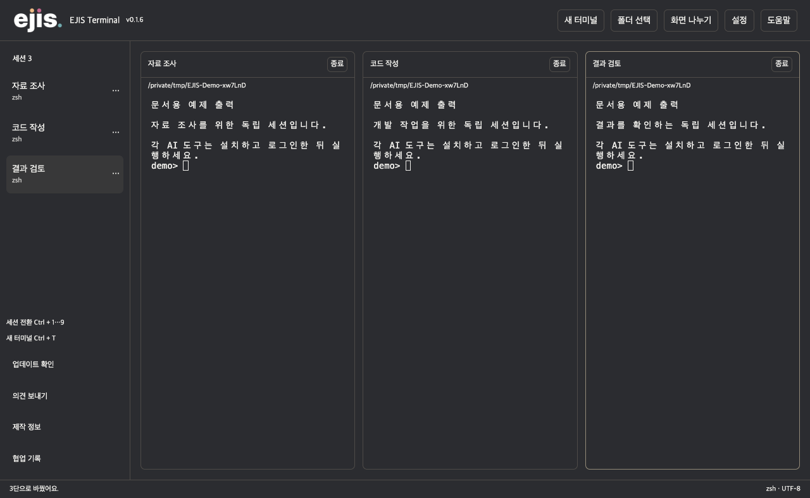
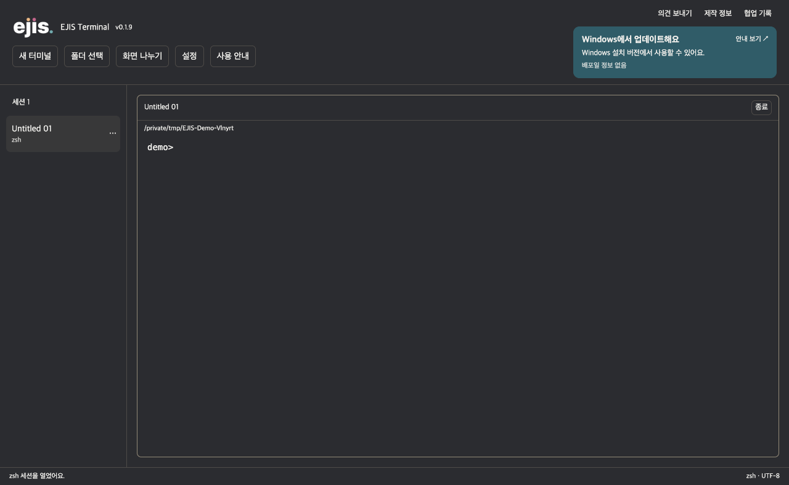
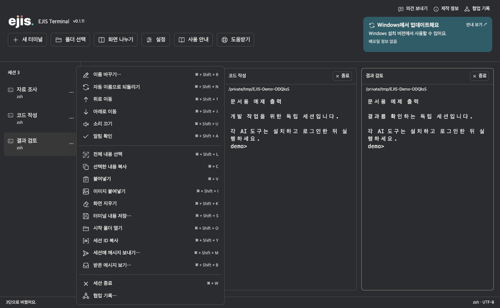
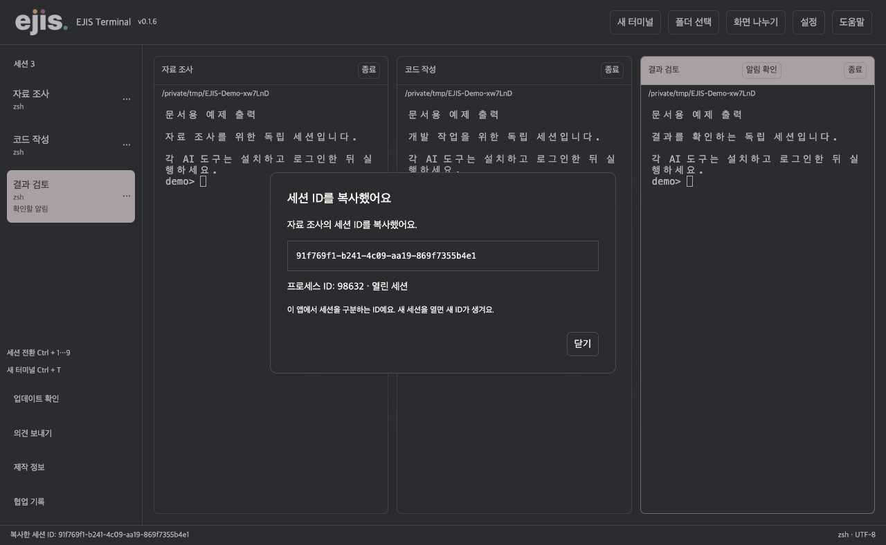
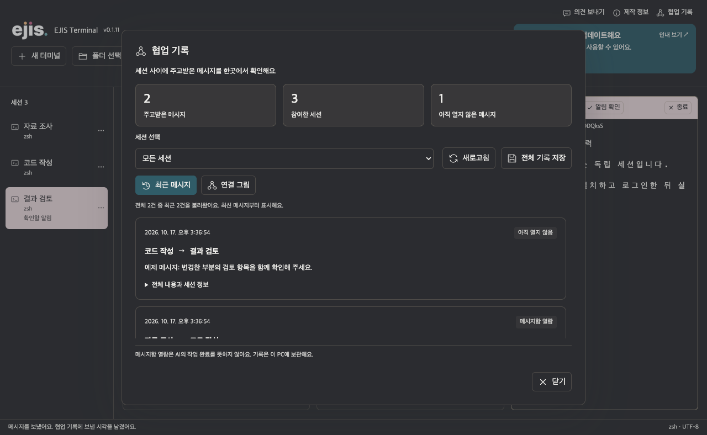
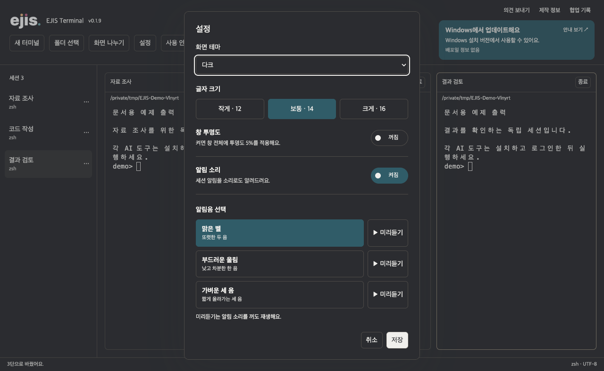

# EJIS Terminal

**cmux의 다중 세션 작업 방식과 사용 경험을 바탕으로, Juik Eom이 직접 사용하기 위해 기획·제작한 Windows 터미널입니다.** 여러 AI 작업을 한 화면에서 살펴보고, 세션마다 역할을 나누어 일할 수 있습니다.

**[Windows 설치 파일 받기](https://github.com/brownailes/ejis-terminal/releases/latest)** · [처음 시작하기](#처음-시작하기) · [단축키](#단축키) · [업데이트 기록](https://github.com/brownailes/ejis-terminal/releases) · [문의하기](mailto:brownailes@gmail.com)

> 이 문서의 스크린샷 6장은 실제 앱의 macOS 개발 환경에서 예제 세션으로 촬영했습니다. 화면의 출력과 메시지는 사용법 설명용입니다. Windows 배포판에서는 PowerShell을 사용하며, 메뉴의 ⌘ 표시는 Ctrl로 바뀝니다. 실제 AI의 작업 결과를 보여주는 화면은 아닙니다.

## 주요 기능

| 하고 싶은 일 | EJIS Terminal에서 할 수 있는 일 |
| --- | --- |
| 여러 작업을 동시에 진행하기 | 최대 20개 독립 세션을 열고, 한 화면을 1단·2단·3단으로 바꿔 볼 수 있습니다. |
| 작업의 흐름 파악하기 | 세션 이름을 직접 정하거나 첫 입력을 바탕으로 자동 지정할 수 있습니다. |
| 마우스 사용 줄이기 | 세션 전환, 이름 변경, 복사·붙여넣기, 메시지 보내기를 단축키로 실행합니다. |
| 텍스트와 이미지 전달하기 | 터미널의 선택한 내용을 복사하고, 클립보드 텍스트나 이미지 파일 경로를 입력합니다. |
| 세션 사이에 메모 남기기 | 보낸 시각과 확인 여부를 기록하고, 메시지 연결 관계를 그림으로 볼 수 있습니다. |
| 내게 맞는 화면 만들기 | 테마, 글자 크기, 투명도, 알림 소리를 조절하고 기본값으로 되돌릴 수 있습니다. |
| 설정 차이 줄이기 | Windows에서 사용자 PowerShell 프로필을 불러오지 않고 공통 실행 옵션으로 시작합니다. 설치한 AI 도구와 계정은 각 PC의 것을 사용합니다. |

## 처음 시작하기

### 1. 설치 파일 받기

1. **[최신 버전 페이지](https://github.com/brownailes/ejis-terminal/releases/latest)**를 엽니다.
2. `Assets`에서 `EJIS-Terminal-버전-x64-setup.exe`를 받아 실행합니다. `Source code` 압축 파일은 설치 파일이 아닙니다.
3. 설치 위치를 정하고 안내에 따라 설치합니다.
4. 바탕화면의 **EJIS Terminal**을 실행합니다.

현재 배포 대상은 **Windows 11 x64**입니다. 앱 자체의 로그인이나 GitHub 계정은 필요하지 않습니다. 현재 설치 파일에는 코드 서명이 없어 Windows에서 게시자를 확인하지 못했다는 안내가 나타날 수 있습니다. 이 저장소의 릴리스에서 받은 파일인지 확인합니다.

### 2. Windows 상태 확인하기

앱이 시작되면 Thinking Orbs 애니메이션과 함께 Windows 업데이트 상태를 확인합니다. 필요한 업데이트나 재시작이 없으면 **터미널 1**로 넘어갑니다. 업데이트가 필요하면 안내에 따라 Windows 설정에서 설치한 뒤 다시 확인합니다.

앱이 Windows 업데이트를 자동으로 설치하거나 PC를 재시작하지는 않습니다. 인터넷 연결, 업데이트 서비스, 조직의 정책에 따라 확인하지 못할 수 있습니다. 확인 대상은 Windows Update가 현재 제공하는 필수 소프트웨어 업데이트이며, 선택 업데이트나 드라이버는 제외합니다. 모든 PC가 동일한 Windows 버전이라는 뜻은 아닙니다.

### 3. 관리자 승인 후 작업하기

Windows 배포판은 시작할 때 관리자 승인을 요청하며, 열린 터미널과 그 안의 명령도 관리자 권한으로 실행됩니다. 승인을 취소하면 앱이 열리지 않습니다. 다른 관리자 계정으로 승인하면 해당 계정의 환경을 사용할 수 있습니다.

관리자 권한과 AI 도구의 작업 승인은 별개입니다. AI 도구의 승인·자동 실행 설정은 각 도구에서 선택하며, EJIS Terminal이 이를 자동 실행 모드로 바꾸지는 않습니다.

### 4. 터미널에서 바로 입력하기

처음에는 **다크 모드 · 터미널 1개 · 1단 화면**으로 시작합니다. 터미널 안을 클릭하고 명령을 입력합니다. 별도 입력창은 없습니다.

Codex나 Claude Code 등 CLI 방식의 AI 도구는 사용자가 설치하고 해당 계정으로 로그인한 뒤 실행합니다. 유료 기능을 사용하려면 각 서비스의 이용 조건을 충족해야 합니다. Antigravity 같은 별도 IDE의 화면을 앱 안에 넣는 기능은 제공하지 않으며, 모든 AI 도구의 호환성을 보장하지는 않습니다.

## 세션과 화면 나누기

- **새 터미널**을 누르면 독립된 세션이 열립니다. 세션마다 실행 중인 명령과 작업 폴더를 따로 관리합니다.
- **폴더 선택**으로 새 작업의 시작 폴더를 정합니다.
- **화면 나누기**에서 1단·2단·3단을 선택합니다.
- 왼쪽 목록에서 세션을 선택하거나 `Ctrl+1`부터 `Ctrl+9`, `Ctrl+Tab`으로 이동합니다.
- 세션 이름은 직접 바꿀 수 있습니다. 자동 이름은 첫 입력을 참고하므로, 민감한 내용이 있다면 이름을 확인합니다.
- 세션 종료는 해당 터미널의 프로세스를 종료합니다. 앱을 다시 열어도 이전 실행 상태가 복원되지는 않습니다.

### 세션 메뉴

왼쪽 세션을 **우클릭**하거나 `···`를 누르면 메뉴가 열립니다. 이름 변경, 이동, 알림 관리, 복사·붙여넣기, 화면 지우기, 내용 저장, 시작 폴더 열기, 메시지와 종료 기능을 사용할 수 있습니다. 메뉴 바깥을 클릭하거나 `Esc`를 누르면 닫힙니다.

메뉴가 열려 있을 때는 그 메뉴의 세션에 단축키가 적용됩니다. 메뉴가 닫힌 상태에서는 현재 선택한 세션에 적용됩니다.

## 복사와 붙여넣기

- 마우스로 터미널의 텍스트를 드래그해 선택한 뒤 **Ctrl+C**를 누르면 복사됩니다.
- 선택한 텍스트가 없으면 **Ctrl+C**는 터미널의 실행 중단 신호로 동작합니다.
- **Ctrl+V**로 클립보드 텍스트를 붙여넣습니다. 여러 줄의 내용은 확인 안내를 거쳐 입력합니다.
- 이미지를 복사한 뒤 붙여넣으면 PC에 PNG 파일로 저장하고, 그 파일의 경로를 터미널에 넣습니다. **이미지 붙여넣기** 메뉴도 사용할 수 있습니다. 한 이미지의 크기는 최대 30MB입니다.
- 이미지를 AI 서비스에 자동 업로드하지는 않습니다. 경로를 받은 AI 도구가 이미지를 읽는 방식과 지원 여부는 해당 도구에 따라 달라집니다.
- **전체 선택**이나 **터미널 내용 저장**으로 현재 남아 있는 터미널 버퍼를 가져올 수 있습니다. 버퍼는 최대 10,000줄이며, 이미 사라진 출력이나 AI 도구의 별도 화면 전체를 복원하지는 않습니다.
- **Shift+Tab**은 터미널 안의 프로그램에 전달됩니다. 어떤 기능으로 동작하는지는 실행 중인 도구가 결정합니다.

0.1.6에서는 클립보드 API 변경으로 붙여넣기 시 발생하던 `availableFormats` 오류를 수정했습니다.

## 세션 ID와 협업 기록

### 실제 세션 ID 확인하기

**세션 ID 복사**를 누르면 실제 열린 세션의 UUID가 복사되고, 복사한 값과 프로세스 번호가 화면에 표시됩니다. 이 ID는 EJIS Terminal 내부의 세션 식별자이며, AI 서비스의 대화 ID나 로그인 토큰이 아닙니다.

### 메시지 보내고 흐름 확인하기

1. 세션 메뉴에서 **세션에 메시지 보내기**를 선택합니다.
2. 받을 세션을 고르고 내용을 입력합니다.
3. 받는 세션에 표시와 소리로 알림이 전달됩니다. 소리는 설정과 세션의 알림 상태에 따라 달라집니다.
4. **받은 메시지 보기**로 확인하면 읽은 시각이 기록됩니다.
5. 왼쪽의 **협업 기록**에서 보낸 사람, 받는 사람, 시각, 내용, 확인 여부를 함께 확인합니다.

연결 그림의 화살표는 실제로 보낸 메시지의 방향을 나타냅니다. 기록은 최근 200개 메시지, 그림은 최대 12개 세션을 보여주며 세션별로 골라 볼 수 있습니다. 전체 기록은 JSONL 파일로, 연결 그림은 SVG 이미지로 저장할 수 있습니다.

이 기능은 **같은 앱 안의 세션 사이에서 사용자가 주고받는 메시지**를 기록합니다. 메시지를 터미널 명령으로 자동 실행하거나, AI의 작업 완료를 자동 판정하거나, 다른 PC의 세션과 연결하지는 않습니다. ‘확인’은 받은 메시지 화면을 열었다는 뜻입니다.

## 화면과 알림 설정

**설정**에서 다음 항목을 바꿀 수 있습니다.

| 항목 | 선택 범위 |
| --- | --- |
| 화면 테마 | 다크 · 라이트 · 시스템 설정 |
| 터미널 글자 크기 | 11~24 |
| 알림 | 소리 켜기·끄기와 음량 |
| 투명도 | 0~40%, 앱 창 전체에 적용 |
| 기본값 | 화면과 알림 설정을 처음 상태로 복원 |

기본값으로 되돌려도 열린 세션과 협업 기록은 삭제하지 않습니다. 메시지 수신이나 터미널의 벨 신호에 맞춰 알림을 표시합니다. 모든 AI 도구의 승인 요청을 자동으로 인식하는 기능은 아닙니다.

## 업데이트하기

앱은 시작할 때와 이후 약 15분마다 새 버전을 확인합니다. **왼쪽의 업데이트 확인**으로 직접 확인할 수도 있습니다.

새 버전이 있으면 **오른쪽 아래**에 안내가 나타납니다. 다운로드와 설치는 사용자가 선택합니다. 작업을 저장한 뒤 설치합니다. 다운로드만 했다고 자동 설치하거나, 앱을 닫을 때 임의로 설치하지 않습니다.

GitHub에 커밋하는 것만으로 설치된 앱이 바뀌지는 않습니다. Windows 빌드와 검증을 마친 새 버전이 릴리스로 공개되어야 앱이 업데이트를 안내합니다. 앱 업데이트와 Windows 운영체제 업데이트는 따로 확인합니다.

## 단축키

Windows 기준입니다. 텍스트 입력란이나 대화상자를 편집할 때는 일부 세션 단축키를 적용하지 않습니다.

| 기능 | 단축키 |
| --- | --- |
| 새 터미널 | Ctrl+T |
| 세션 선택 | Ctrl+1~9 |
| 다음 세션 | Ctrl+Tab |
| 시작 폴더 선택 | Ctrl+O |
| 화면 나누기 | Ctrl+Shift+D |
| 설정 | Ctrl+, |
| 이름 바꾸기 | Ctrl+Shift+R |
| 자동 이름 사용 | Ctrl+Shift+N |
| 위로·아래로 이동 | Ctrl+Shift+↑ / ↓ |
| 세션 알림 끄기·켜기 | Ctrl+Shift+U |
| 알림 확인 | Ctrl+Shift+A |
| 터미널 전체 선택 | Ctrl+Shift+L |
| 선택한 내용 복사 | Ctrl+C / Ctrl+Shift+C |
| 붙여넣기 | Ctrl+V / Ctrl+Shift+V |
| 이미지 붙여넣기 | Ctrl+Shift+I |
| 화면 지우기 | Ctrl+Shift+K |
| 터미널 내용 저장 | Ctrl+Shift+S |
| 시작 폴더 열기 | Ctrl+Shift+O |
| 세션 ID 복사 | Ctrl+Shift+Y |
| 세션에 메시지 보내기 | Ctrl+Shift+M |
| 받은 메시지 보기 | Ctrl+Shift+B |
| 세션 종료 | Ctrl+W |

## 데이터와 지원 범위

설정, 붙여넣은 이미지, 메시지 본문과 협업 기록은 PC의 앱 데이터 폴더에 저장됩니다. 기본값 버튼으로 삭제되지 않습니다. EJIS Terminal이 이 내용을 AI 서비스로 자동 전송하지는 않지만, 터미널에서 실행하는 AI 도구의 데이터 처리 방식은 각 도구의 정책을 따릅니다.

| 구분 | 현재 상태 |
| --- | --- |
| Windows 11 x64 | 설치 파일 제공, 초기 배포 단계 |
| macOS | 개발·검증 환경에서 사용, 정식 설치 파일·자동 업데이트 미제공 |
| Linux / Windows ARM | 정식 지원 미검증 |
| 검증 | 자동화 테스트, 실제 PTY 입력, Windows 빌드·관리자 실행 설정 검증. 실제 사용자 PC별 환경은 추가 확인이 필요합니다. |
| 아직 제공하지 않는 기능 | 실행 세션 복구, 다른 PC와의 세션 동기화, AI 작업 상태의 범용 자동 감지 |

이 공개 저장소는 **설치 파일, 업데이트 정보, 사용 안내와 스크린샷**을 배포하는 곳입니다. 프로그램 소스는 비공개이며, 공개 소스 프로젝트로 배포하는 것은 아닙니다. 사용한 구성 요소의 저작권과 라이선스는 [타사 소프트웨어 고지](THIRD-PARTY-NOTICES.md)에서 확인할 수 있습니다.

## 제작 배경

cmux를 사용하면서 익숙해진 다중 세션 구성과 세션 메뉴를 Windows에서도 제 작업 방식에 맞춰 사용하고 싶어 만들었습니다. 제가 직접 사용할 도구로 시작했고, 필요한 기능을 더하며 개선하고 있습니다.

여기서 cmux를 바탕으로 만들었다는 설명은 **사용 경험과 기능 구성을 참고했다는 뜻**입니다. 기능 구현 코드는 별도로 작성했으며, cmux나 cmux for Windows 소스코드의 포크는 아닙니다. cmux의 공식 제품이나 제휴 제품은 아닙니다. 사용한 외부 구성요소의 개발자와 라이선스는 [타사 소프트웨어 고지](THIRD-PARTY-NOTICES.md)에 표시했습니다.

## 문의하기

앱의 **의견 보내기**를 누르거나 [brownailes@gmail.com](mailto:brownailes@gmail.com)으로 문의할 수 있습니다. 앱은 작성한 내용을 메일 작성 화면으로 전달하며, 사용자가 보내기를 완료해야 접수됩니다. 터미널 기록은 자동 첨부하지 않습니다.

문제가 생기면 앱 버전, Windows 버전, 문제가 생긴 순서와 오류 메시지를 함께 보내면 원인 파악에 도움이 됩니다. 스크린샷을 보낼 때는 비밀번호나 API 키가 보이지 않는지 확인합니다.

**Juik Eom · 특수교사**

**ejis** · brownailes@gmail.com
